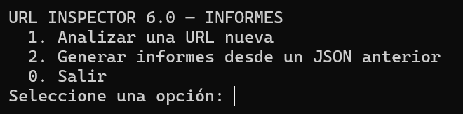
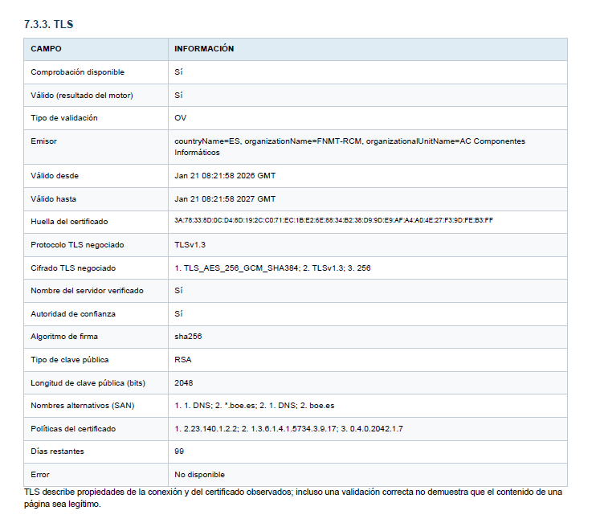

# URL Inspector 6.0

[](https://github.com/darboledas/url-inspector/actions/workflows/ci.yml)


[](LICENSE)

**Analizador defensivo de URL con evaluación técnica y reputacional, puntuación heurística de riesgo y generación de informes técnicos, periciales y ejecutivos.** Disponible para **Windows y Linux**, mediante terminal y menú interactivo.

URL Inspector permite examinar una dirección web y documentar indicadores relacionados con redirecciones, identidad del dominio, infraestructura, DNS/RDAP, certificados TLS, HTTP, contenido HTML y fuentes externas de reputación. Se orienta al análisis técnico y a la investigación defensiva; **no determina por sí solo que un sitio sea seguro, legítimo o delictivo**.

> **Versiones:** URL Inspector **6.0** · motor estable y calibrado **1.18.1** · complemento opcional de informes **1.3.2**. La interfaz gráfica de Windows todavía no forma parte de esta distribución.

## ¿Para qué sirve?

- **Examinar enlaces sospechosos** y documentar sus indicadores técnicos y reputacionales.
- **Investigar incidentes** que involucren enlaces recibidos por correo, mensajería u otros canales, aplicando las precauciones operativas correspondientes.
- **Analizar listados de URL** desde archivos TXT/CSV mediante el modo por lotes (*batch*).
- **Conservar resultados estructurados** en JSON y generar documentos en HTML o PDF para su revisión y comunicación.
- **Preparar borradores de informes periciales**, con estructura inspirada en **UNE 197001:2019**, o informes ejecutivos para lectores no especializados.
- **Repetir la exportación de informes sin repetir la inspección** a partir de un JSON anterior.

## ¿Quién puede utilizarlo?

Está dirigido a profesionales de ciberseguridad, equipos de respuesta a incidentes, analistas de amenazas, peritos informáticos, investigadores, docentes y estudiantes con conocimientos básicos de Python y seguridad web. También puede utilizarse en auditorías y ejercicios formativos autorizados.

El programa está pensado para **uso defensivo y autorizado**. El acceso a una URL potencialmente maliciosa implica riesgos y puede generar conexiones observables por terceros.

## Características y ventajas

| Característica | Qué aporta |
| --- | --- |
| Análisis de múltiples capas | Integra señales de URL, dominio, infraestructura, HTTP, TLS y HTML. |
| Reputación externa diferenciada | Presenta alertas y cobertura reputacional por separado de la puntuación heurística. |
| Escala documentada | Ofrece niveles operativos de riesgo de 1 a 5, con metodología y limitaciones publicadas. |
| Informes reutilizables | Produce resultados JSON y exportaciones técnicas; el complemento añade pericial PDF/HTML y ejecutivo PDF. |
| Trabajo sin volver a inspeccionar | Permite generar informes desde un JSON anterior conservando el archivo de entrada. |
| Procesamiento por lotes | Admite listas TXT/CSV, deduplicación, reanudación y comprobación previa sin conexiones. |
| Reproducibilidad | Incluye pruebas automáticas, documentación de validación y manifiesto de integridad SHA-256. |
| Multiplataforma | Lanzadores de terminal para Windows (`.bat`) y Linux (`.sh`). |

Las fuentes externas pueden requerir claves, cuotas o disponibilidad de servicios de terceros. Una fuente no consultada debe interpretarse como **no evaluada**, nunca como resultado negativo.

## Inicio rápido

### Requisitos

- **Python 3.11 o superior**, con `pip` y `venv` disponibles.
- Conexión a Internet para descargar dependencias la primera vez, salvo que se hayan instalado previamente desde un origen autorizado.
- Entorno aislado o controlado al analizar destinos potencialmente hostiles.

Descargue el repositorio mediante **Code → Download ZIP** en GitHub, descomprímalo y conserve los archivos juntos. Si utiliza Git:

```bash
git clone https://github.com/darboledas/url-inspector.git
cd url-inspector
```

### Windows — menú interactivo

Desde el Explorador de archivos, haga doble clic en:

```text
ejecutar_url_inspector_INFORMES_UNE.bat
```

También puede abrir CMD en la carpeta y ejecutar:

```bat
ejecutar_url_inspector_INFORMES_UNE.bat
```

El lanzador prepara un entorno virtual local `.venv` cuando es necesario y abre el menú para analizar una URL nueva o generar informes desde un JSON anterior. Los resultados se guardan por defecto en `informes_locales/`, excluido del repositorio.



*Figura 1. Menu interactivo del complemento de informes 1.3.2 en Windows.*

### Linux — menú interactivo

Desde un terminal, en la carpeta del repositorio:

```bash
chmod +x ejecutar_url_inspector_INFORMES_UNE.sh
./ejecutar_url_inspector_INFORMES_UNE.sh
```

El permiso de ejecución se configura una sola vez si resulta necesario. Como alternativa puede ejecutar `bash ejecutar_url_inspector_INFORMES_UNE.sh`. Si falta `venv`, instale el paquete correspondiente a su distribución.

### Opciones del menú

```text
1. Analizar una URL nueva
2. Generar informes desde un JSON anterior
0. Salir
```

Después de obtener un JSON, se puede elegir **pericial PDF + HTML**, **solo ejecutivo PDF**, **ambos tipos**, **solo pericial HTML** o **ningún informe adicional**. La selección de informes no vuelve a inspeccionar la URL.

Para todas las opciones, instrucciones y advertencias, consulte [INFORMES_UNE_197001.md](INFORMES_UNE_197001.md).

## Uso avanzado mediante terminal

Si prefiere instalar las dependencias manualmente:

```bash
python -m pip install -r requirements_v6.txt
```

**Inspección individual** de un dominio de ejemplo:

```bash
python url_inspector_6.0.py https://example.com --full
```

**Exportación desde un análisis anterior, sin nueva inspección de la URL** (las dependencias deben estar disponibles):

```bash
python informes_une_197001.py resultados.json --pericial pericial.pdf --pericial-html pericial.html --ejecutivo ejecutivo.pdf
```

**Comprobación de un listado sin realizar conexiones:**

```bash
python batch_url_inspector.py batch_urls_ejemplo.txt --dry-run
```

**Ejecución activa por lotes** (contacta los destinos y requiere confirmación expresa):

```bash
python batch_url_inspector.py urls.txt --acknowledge-risk
```

Las capturas de pantalla con navegador headless **no se activan con `--full`**: requieren `--screenshot` y se desaconsejan fuera de un entorno aislado al trabajar con sitios potencialmente hostiles. Para las demás opciones, consulte [el manual técnico](README_URL_Inspector_6.0.md).

## Interpretación de resultados

La puntuación de **0 a 100 es heurística y no representa una probabilidad estadística de phishing, malware o fraude**.

| Puntuación | Nivel operativo |
| ---: | --- |
| 0–7 | 1 — Bajo |
| 8–19 | 2 — Moderado |
| 20–29 | 3 — Alto |
| 30–49 | 4 — Muy alto |
| 50–100 | 5 — Crítico |

En una **validación independiente documentada de 600 URL** (300 maliciosas y 300 benignas), el umbral de 8 puntos alcanzó **84,3 % de sensibilidad**, **91,3 % de especificidad** y **87,4 % de F1**. Estas métricas describen aquella campaña y **no garantizan el rendimiento con URL nuevas ni sustituyen una evaluación específica del contexto de uso**.

Consulte [la calibración](CALIBRACION_ESCALA_RIESGO.md) y [el informe de validación independiente](docs/VALIDACION_INDEPENDIENTE_600.md), incluidos sus límites metodológicos.

El **veredicto reputacional** se presenta por separado de la puntuación, para evitar que una alerta externa relevante quede oculta por una puntuación baja. La ausencia de alertas no garantiza seguridad.

## Informes periciales y ejecutivos

El complemento **1.3.2** permite generar un **borrador de informe pericial PDF y HTML** que reproduce los resultados disponibles, así como un **informe ejecutivo PDF** con una síntesis operativa. Puede incorporar, si existe, la transcripción real de consola y documentar huellas SHA-256.

La estructura pericial toma como referencia **UNE 197001:2019**, pero **no implica certificación de conformidad ni sustituye la intervención profesional**, la adquisición y preservación de evidencias, la cadena de custodia o la firma del perito. Los metadatos profesionales deben revisarse y cumplimentarse fuera del repositorio público.

La cobertura técnica ponderada de cinco componentes **no equivale a exhaustividad del análisis ni a legitimidad del sitio**. Véanse [las instrucciones del complemento](INFORMES_UNE_197001.md) y [las notas de la versión 1.3.2](REVISION_INFORMES_1.3.2.md).

### Ejemplos de informes generados



*Figura 2. Analisis TLS de www.boe.es: extracto de un borrador pericial generado por URL Inspector 6.0.*


## Seguridad y privacidad

URL Inspector aplica restricciones a destinos locales y no públicos, validación de redirecciones y medidas frente a SSRF y DNS rebinding. Estas protecciones reducen riesgos, pero no convierten el análisis activo de sitios hostiles en una operación exenta de peligro.

- No abra manualmente las URL históricas potencialmente maliciosas incluidas en el corpus de regresión.
- No publique archivos JSON de casos reales, informes, transcripciones, credenciales, claves API ni información personal.
- Algunas consultas pueden acceder a proveedores externos; considere las implicaciones de confidencialidad antes de usarlas.
- Las credenciales se configuran mediante variables de entorno; consulte [el manual técnico](README_URL_Inspector_6.0.md) y [la política de seguridad](SECURITY.md).
- Una exportación offline no vuelve a contactar la URL analizada, pero la primera instalación de dependencias puede requerir conexión a Internet.

## Verificación y reproducibilidad

Pruebas automáticas:

```bash
python -m unittest discover -s tests -p "test_*.py"
```

El repositorio incluye integración continua para **Windows y Ubuntu, con Python 3.11 y 3.13**, además de un [manifiesto SHA-256](SHA256SUMS.txt) y material para reproducir comprobaciones técnicas. La aprobación de CI se refiere a las pruebas automatizadas incluidas, no a una certificación general del software.

El **motor 1.18.1 se mantiene congelado**; su SHA-256 es:

```text
30c9df71e46a8444e02af91e9cc2b50c29b323a38e9b9333373fd63bf954bc6a
```

El corpus histórico sirve para regresión y **no debe reutilizarse como única validación de cambios futuros**. Toda modificación de heurísticas, pesos o umbrales exige una campaña independiente con muestras nuevas y sin solapamiento de URL ni host.

## Documentación adicional

- [Manual técnico y configuración de fuentes](README_URL_Inspector_6.0.md)
- [Complemento de informes periciales y ejecutivos](INFORMES_UNE_197001.md)
- [Revisión del complemento 1.3.2](REVISION_INFORMES_1.3.2.md)
- [Metodología del benchmark](README_BENCHMARK.md)
- [Validación independiente de 600 URL](docs/VALIDACION_INDEPENDIENTE_600.md)
- [Pruebas y CI](README_TESTS.md)
- [Notas de versión](RELEASE_NOTES.md)
- [Seguridad](SECURITY.md)
- [Licencia](LICENSE)

## Licencia y autoría

**Copyright © 2026 David Arboledas.** Distribuido bajo la [licencia MIT](LICENSE), que permite usar, modificar y redistribuir el software conforme a sus condiciones. Se proporciona **sin garantías**.
